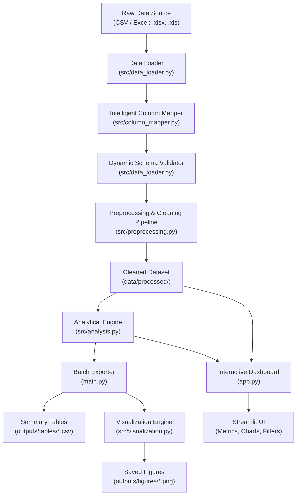

# 📊 Employee Attrition Analysis & HR Analytics Platform

[](https://www.python.org/downloads/)
[](https://streamlit.io/)
[](https://docs.pytest.org/)
[](https://opensource.org/licenses/MIT)

An enterprise-grade, production-structured HR analytics platform designed to analyze employee turnover, identify attrition patterns, and evaluate workforce risk factors.

The platform operates in two modes:
1. **Interactive Streamlit Web Dashboard** (`app.py`): Real-time exploratory data analysis, interactive filtering, dynamic column schema mapping, and one-click data template downloads.
2. **Automated Batch Processing Pipeline** (`main.py`): Command-line batch runner for enterprise ELT, generating sanitized datasets, summary CSVs, and high-resolution charts.

Supports **both bundled historical datasets and dynamic user-provided datasets** in **CSV** or **Excel (`.xlsx`, `.xls`)** format with intelligent column resolution and partial-schema resilience.

---

## 📑 Table of Contents

- [Architecture & System Design](#-architecture--system-design)
- [Key Features](#-key-features)
- [Project Structure](#-project-structure)
- [Quick Start & Installation](#-quick-start--installation)
- [File Upload Guidelines for Users](USER_UPLOAD_GUIDE.md)
- [Usage Guide](#-usage-guide)
  - [Interactive Dashboard](#1-interactive-streamlit-dashboard)
  - [Batch Processing CLI](#2-batch-processing-cli)
- [Dynamic Ingestion & Column Mapping Engine](#-dynamic-ingestion--column-mapping-engine)
- [Data Preprocessing Pipeline](#-data-preprocessing-pipeline)
- [Analytical Dimensions](#-analytical-dimensions)
- [Testing & Quality Assurance](#-testing--quality-assurance)
- [Configuration Reference](#-configuration-reference)
- [Developer Guidelines](#-developer-guidelines)

---

## 🏛️ Architecture & System Design

The application follows clean architectural principles with strict separation of concerns:



### Module Responsibilities

| Module | Location | Primary Responsibility |
| :--- | :--- | :--- |
| **Config** | `config.py` | Single source of truth for file paths, domain ranges, column aliases, mappings, and plot settings. |
| **Batch Pipeline** | `main.py` | Orchestrates headless batch execution via CLI flags (`--input`). |
| **Dashboard** | `app.py` | Interactive web UI with file uploader, schema viewer, and adaptive visual sections. |
| **Data Loader** | `src/data_loader.py` | Multi-format reader (CSV encodings, Excel), buffer streaming, and schema validation. |
| **Column Mapper** | `src/column_mapper.py` | Exact, normalized, alias, and fuzzy matching between custom headers and canonical schema. |
| **Preprocessing** | `src/preprocessing.py` | Deduplication, type conversion, range clamping, target cleaning, and median/mode imputation. |
| **Analytics Engine** | `src/analysis.py` | Dimension-level attrition calculations, dynamic binning, correlations, and summary tables. |
| **Visualization** | `src/visualization.py` | Guarded, publication-ready Matplotlib & Seaborn chart generators. |
| **Utilities** | `src/utils.py` | Directory scaffolding, standardized logging, and CSV exports. |

---

## ✨ Key Features

- **Dynamic File Ingestion**: Upload any employee dataset via Streamlit drag-and-drop or CLI `--input` argument. Supports `.csv`, `.xlsx`, and `.xls`.
- **Intelligent Header Auto-Mapping**: Automatically detects column names using exact matching, normalization, 200+ enterprise aliases (`salary` $\rightarrow$ `MonthlyIncome`, `tenure` $\rightarrow$ `YearsAtCompany`, `dept` $\rightarrow$ `Department`), and fuzzy matching.
- **Strict Schema Enforcement (No Extra Entities)**: Disallows unexpected extra columns outside the sample CSV schema. If any unknown entity is found, the system halts immediately and provides a detailed error identifying the exact extra fields.
- **Flexible Binary Target Encoding**: Understands standard attrition representations (`Yes`/`No`, `1`/`0`, `True`/`False`, `left`/`stayed`, `terminated`/`employed`, `voluntarily separated`/`active`).
- **Partial-Schema Resilient**: Only `Attrition` is mandatory. Missing optional columns (e.g. no survey or salary data) are gracefully handled—the engine processes available dimensions without crashing.
- **Data Quality Auditing**: Compares raw vs. cleaned datasets side-by-side, tracking removed duplicates, imputed missing values, and clamped anomalies.
- **Zero-Data-Loss Design**: Raw datasets are read-only and never overwritten; sanitized artifacts are saved separately to `data/processed/`.
- **Comprehensive Test Coverage**: 52 automated tests verifying loaders, mappers, cleaners, analytics, charts, extra entity rejection, and CLI execution.

---

## 📂 Project Structure

```text
employee-attrition-analysis/
├── app.py                     # Streamlit interactive web application
├── main.py                    # Batch command-line pipeline runner
├── config.py                  # Central configuration and schema definitions
├── requirements.txt           # Python package dependencies
├── pytest.ini                 # Pytest configuration and path discovery
├── README.md                  # Project overview and quick start (this file)
├── USER_UPLOAD_GUIDE.md       # Step-by-step user file preparation & upload guide
│
├── data/                      # Dataset repository
│   ├── raw/                   # Immutable raw datasets (e.g. employee_attrition_messy_8040.csv)
│   ├── processed/             # Sanitized datasets (e.g. employee_attrition_cleaned.csv)
│   └── README.md              # Dataset schema and custom file formatting guide
│
├── outputs/                   # Generated pipeline artifacts
│   ├── figures/               # High-resolution PNG charts (DPI=150)
│   ├── tables/                # Aggregated summary CSV exports
│   └── reports/               # Executive summaries and data audit logs
│
├── src/                       # Core Python packages
│   ├── __init__.py
│   ├── analysis.py            # Aggregations, rates, correlations, dynamic binning
│   ├── column_mapper.py       # Header normalization, alias lookup, fuzzy matching
│   ├── data_loader.py         # Multi-format ingestion, encoding fallbacks, validation
│   ├── preprocessing.py       # Cleaning, deduplication, imputation, range checks
│   ├── utils.py               # File I/O, directory creation, logging setup
│   ├── visualization.py       # Matplotlib & Seaborn chart rendering
│   └── README.md              # Deep-dive technical documentation for src/
│
└── tests/                     # Automated test suite
    ├── test_dynamic_ingestion.py     # CSV/Excel, column mapper, CLI tests
    ├── test_phase2_remediation.py    # Schema fixes and DRY refactoring tests
    ├── test_preprocessing.py         # Cleaning and imputation unit tests
    └── README.md                     # Test suite documentation and guide
```

---

## 🚀 Quick Start & Installation

### Prerequisites
- Python 3.12 or newer
- Git

### 1. Clone the Repository
```bash
git clone https://github.com/your-username/employee-attrition-analysis.git
cd employee-attrition-analysis
```

### 2. Create and Activate a Virtual Environment
```bash
# macOS / Linux
python3 -m venv .venv
source .venv/bin/activate

# Windows (Command Prompt / PowerShell)
python -m venv .venv
.venv\Scripts\activate
```

### 3. Install Dependencies
```bash
pip install --upgrade pip
pip install -r requirements.txt
```

---

## 💻 Usage Guide

### 1. Interactive Streamlit Dashboard

Launch the interactive dashboard in your browser:
```bash
streamlit run app.py
```

#### Dashboard Features:
- **Data Source Switcher**:
  - *Default HR Dataset*: Uses the project's bundled dataset (`data/raw/employee_attrition_messy_8040.csv`).
  - *Upload CSV or Excel File*: Upload your own `.csv`, `.xlsx`, or `.xls` spreadsheet.
- **CSV Template Download**: Click **"📥 Download Sample CSV Template"** in the sidebar to download a canonical template with pre-filled headers and sample rows.
- **Schema Mapping Review**: Expand **"🔍 Schema Mapping & Column Detection"** to inspect how your uploaded columns were mapped to canonical attributes.
- **Adaptive Sidebar Filters**: Filter by Department, Job Role, Overtime, Travel, etc. Filters dynamically adapt depending on which columns exist in your dataset.
- **Interactive Visualizations**:
  - Executive KPI cards (Total Headcount, Attrition Count, Attrition Rate, Avg Income, Avg Tenure).
  - Department and Job Role turnover rates.
  - Salary band distributions and compensation impact.
  - Age and tenure cohort comparisons.
  - Job satisfaction and work-life balance breakdowns.
  - Pearson correlation matrix across numerical variables.
  - Raw vs. Cleaned Data Quality audit table.

---

### 2. Batch Processing CLI

Run the headless pipeline to clean data, compute aggregations, and export summary CSVs and PNG charts:

#### Default Dataset:
```bash
python main.py
```

#### Custom CSV or Excel File:
```bash
python main.py --input /path/to/custom_employees.xlsx
# or short flag:
python main.py -i /path/to/custom_employees.csv
```

#### Output Locations:
- Cleaned CSV: `data/processed/employee_attrition_cleaned.csv`
- Summary Tables: `outputs/tables/` (`attrition_summary.csv`, `department_summary.csv`, etc.)
- Visualization Figures: `outputs/figures/` (`attrition_distribution.png`, `correlation_heatmap.png`, etc.)

---

## 🔍 Dynamic Ingestion & Column Mapping Engine

Custom spreadsheets often use inconsistent header naming conventions. The column resolution engine in `src/column_mapper.py` resolves headers using a 4-tier matching algorithm:

```text
User Header: "Monthly Salary"
 ├── [Tier 1: Exact Match]             -> No direct match with "MonthlyIncome"
 ├── [Tier 2: Normalized Match]        -> "monthly_salary" != "monthly_income"
 ├── [Tier 3: Alias Dictionary Lookup] -> "monthly_salary" is an alias for "MonthlyIncome" -> MATCH!
 └── [Tier 4: Fuzzy Match (difflib)]   -> (Fallback if Tier 3 fails)
```

### Supported Column Aliases (Sample)

| Canonical Name | Common Aliases Detected |
| :--- | :--- |
| **`Attrition`** *(Mandatory)* | `attrition`, `left`, `left_company`, `left_org`, `turnover`, `churn`, `status`, `resigned`, `separated`, `exit` |
| **`MonthlyIncome`** | `salary`, `monthly_salary`, `income`, `earnings`, `pay`, `base_pay`, `gross_salary`, `salary_amount` |
| **`YearsAtCompany`** | `tenure`, `company_tenure`, `years_with_company`, `length_of_service` |
| **`Department`** | `dept`, `dept_name`, `division`, `business_unit`, `team`, `functional_area` |
| **`JobRole`** | `role`, `work_role`, `job_title`, `title`, `position`, `designation` |
| **`EmployeeID`** | `emp_id`, `id`, `staff_id`, `emp_no`, `emp_num`, `badge_id` |

> 🛑 **Strict Schema Rule (No Extra Entities):**  
> Custom files must contain **only attributes corresponding to the sample CSV schema**.  
> If an uploaded file contains unrecognized or extra entities (e.g. `Bonus`, `Country`, `Hobbies`), the validation engine halts immediately and presents a detailed error listing all offending columns. Refer to [USER_UPLOAD_GUIDE.md](USER_UPLOAD_GUIDE.md) for full instructions.

---

## 🧹 Data Preprocessing Pipeline

The modular pipeline in `src/preprocessing.py` sanitizes messy real-world data in 8 deterministic steps:

1. **Categorical Standardization**: Strips leading/trailing whitespace, harmonizes casing (e.g. `MALE` $\rightarrow$ `Male`), and standardizes `Attrition` to `"Yes"` / `"No"`.
2. **Data Type Conversion**: Enforces standard numeric dtypes (`int64`, `float64`), string categoricals, and converts `Education` from text levels (`Bachelor`, `Master`, etc.) to ordinal integers (1–5).
3. **Exact Row Deduplication**: Removes duplicate records resulting from batch export glitches.
4. **Employee ID Deduplication**: Drops duplicate ID entries, keeping the first occurrence.
5. **Numerical Range Validation**: Replaces out-of-range anomalies (e.g., negative tenure, age $> 100$, monthly income $< 1,000$) with `NaN`.
6. **Target Sanity Check**: Rows with missing or ambiguous `Attrition` values are dropped.
7. **Missing Value Imputation**:
   - Numerical columns $\rightarrow$ Imputed with the column **median**.
   - Categorical columns $\rightarrow$ Imputed with the column **mode**.
8. **Final Data Quality Verification**: Confirms complete absence of `NaN`s in the cleaned dataset before analytical handoff.

---

## 📈 Analytical Dimensions

| Dimension | Primary Metric | Grouping Logic |
| :--- | :--- | :--- |
| **Overall Attrition** | Attrition % | Headcount vs. Turnover Count |
| **Department** | Attrition % by Department | Grouped by functional unit (R&D, Sales, HR) |
| **Job Role** | Attrition % by Role | Ranked highest to lowest turnover |
| **Salary Bands** | Attrition % by Income Tier | `< ₹3,000`, `₹3,000–₹5,000`, `₹5,000–₹10,000`, `₹10,000–₹15,000`, `₹15,000+` |
| **Age Groups** | Attrition % by Age Cohort | `< 25`, `25–34`, `35–44`, `45–54`, `55+` |
| **Tenure Groups** | Attrition % by Years at Firm | `0–2 Years`, `3–5 Years`, `6–10 Years`, `11–20 Years`, `20+ Years` |
| **Employee Satisfaction** | Attrition % by Satisfaction Score | Job Satisfaction, Environment Satisfaction, Relationship, Work-Life Balance (1–4) |
| **Work Patterns** | Attrition % by Overtime / Travel | OverTime (`Yes`/`No`), BusinessTravel, RemoteWork |
| **Correlations** | Pearson Correlation Matrix | Inter-variable association with `AttritionBinary` (1=Yes, 0=No) |

---

## 🧪 Testing & Quality Assurance

Testing is executed with `pytest` and configured via `pytest.ini`.

### Run the Full Test Suite
```bash
pytest -v
```

### Run Specific Test Modules
```bash
# Dynamic ingestion, file loading, and CLI tests
pytest tests/test_dynamic_ingestion.py -v

# Preprocessing and cleaning tests
pytest tests/test_preprocessing.py -v

# Schema rectification and DRY remediation tests
pytest tests/test_phase2_remediation.py -v
```

### Test Suite Structure (52 Tests)
- `tests/test_dynamic_ingestion.py`: Validates multi-encoding CSV loading, Excel (`.xlsx`) parsing, alias resolution, fuzzy matching, flexible attrition target conversions, partial-schema resilience, extra entity rejection, and CLI batch runs.
- `tests/test_preprocessing.py`: Validates deduplication, outlier replacement, target handling, missing value imputation, and schema preservation.
- `tests/test_phase2_remediation.py`: Validates centralized configurations, binary encodings, ordinal education mappings, and visualization refactoring.

---

## ⚙️ Configuration Reference

All application parameters are centralized in `config.py`:

```python
# Supported Ingestion Formats
SUPPORTED_FILE_EXTENSIONS = [".csv", ".xlsx", ".xls"]

# Mandatory Target
MANDATORY_COLUMNS = ["Attrition"]

# Plotted Figure Settings
FIGURE_DPI = 150
FIGURE_FORMAT = "png"

# Standard Income Bins
SALARY_BINS = [0, 3000, 5000, 10000, 15000, float("inf")]
SALARY_LABELS = ["< 3k", "3k-5k", "5k-10k", "10k-15k", "15k+"]

# Standard Age Bins
AGE_BINS = [0, 25, 35, 45, 55, float("inf")]
AGE_LABELS = ["< 25", "25-34", "35-44", "45-54", "55+"]

# Standard Tenure Bins
TENURE_BINS = [-1, 2, 5, 10, 20, float("inf")]
TENURE_LABELS = ["0-2 Years", "3-5 Years", "6-10 Years", "11-20 Years", "20+ Years"]
```

---

## 👨‍💻 Developer Guidelines

When contributing or extending this codebase, adhere to the following conventions:

1. **Keep `config.py` the Single Source of Truth**: Never hardcode column names, bin thresholds, or file paths in individual scripts.
2. **Defensive Partial-Schema Coding**: Always guard new analysis or visualization routines against missing columns (e.g. `if "ColumnName" in dataframe.columns:`).
3. **Preserve Immutability of Raw Data**: Never write back to `data/raw/`. Always output sanitized data to `data/processed/`.
4. **Strict Typing & Docstrings**: All public functions must include type annotations and NumPy/Google-style docstrings describing parameters, return types, and exceptions.
5. **Add Regression Tests**: When adding new aliases or features, add corresponding test cases in `tests/test_dynamic_ingestion.py` and ensure the full test suite passes.

---

## 📄 License

This project is licensed under the MIT License - see the LICENSE file for details.
